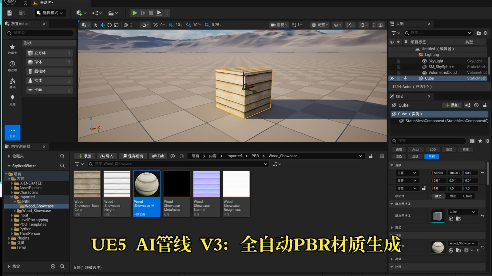
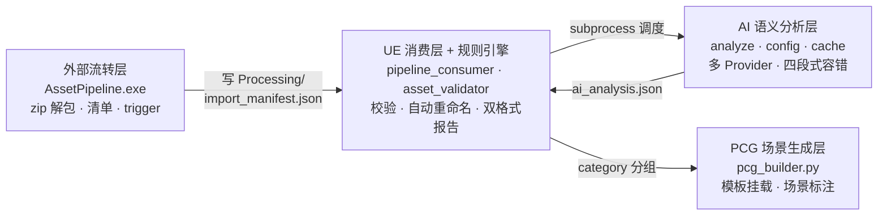
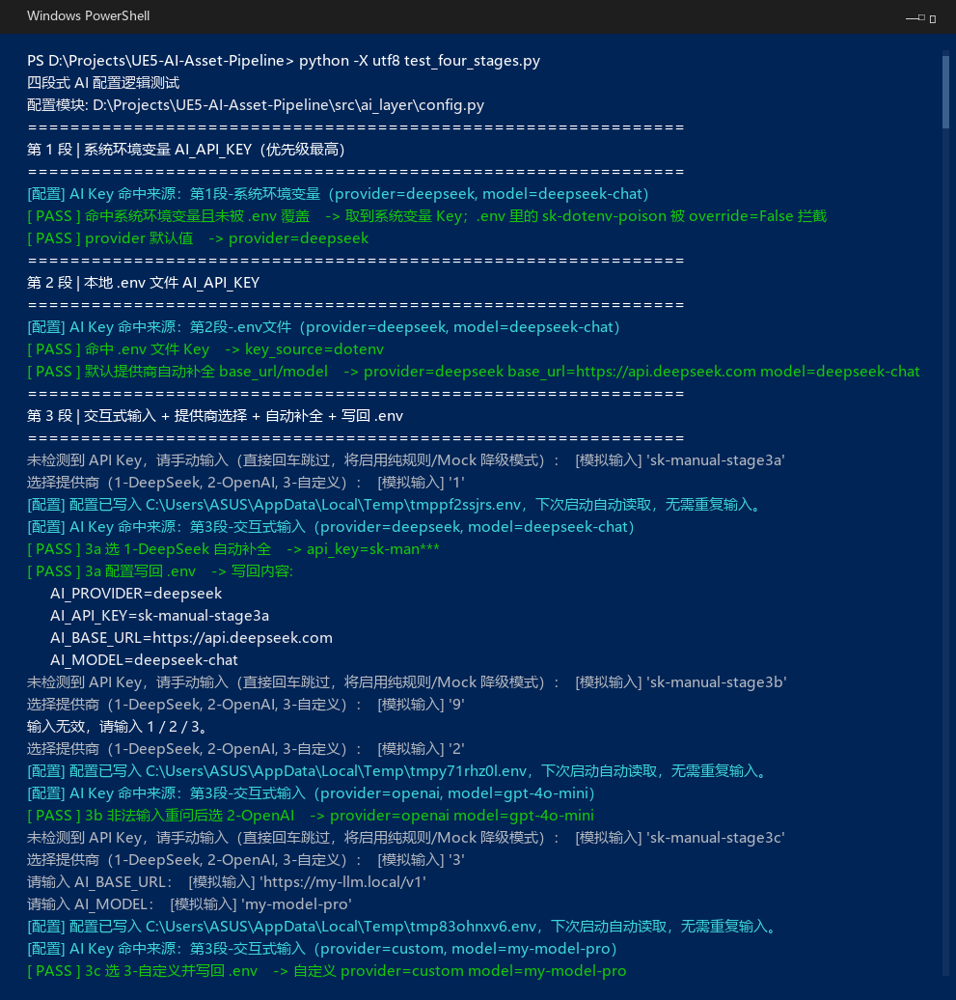
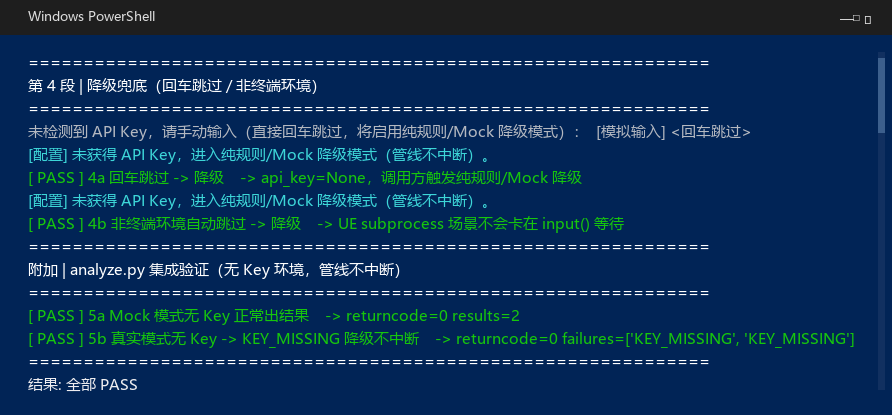
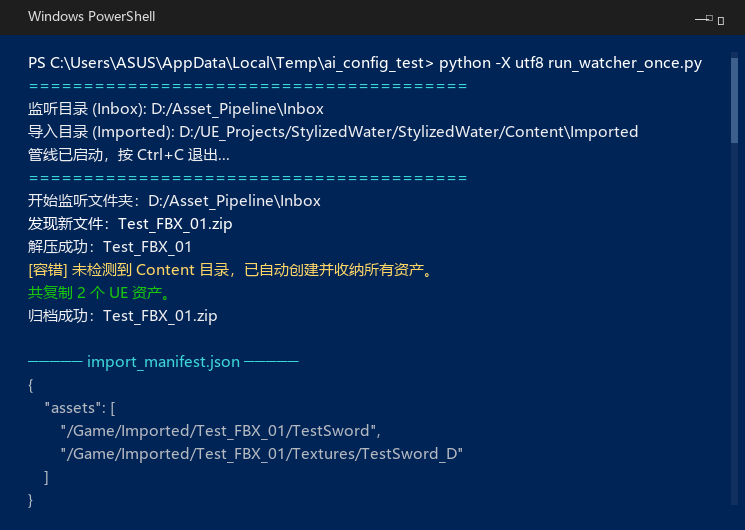

# UE5 AI 增强型资产智能管线

> 让资产管线长出大脑：AI 语义分析驱动的资产校验、智能命名与 PCG 场景生成全自动流水线 —— 支持 DeepSeek / OpenAI 多模型可插拔，Key 缺失零中断。

> 🚀 **下载即用**：非技术用户直接下载 `AssetPipeline.exe` **双击即可运行**，**首次运行会自动引导配置 DeepSeek API Key**（跳过则自动降级，管线照常运转）。

  

## 🎬 演示视频

[](https://www.bilibili.com/video/BV1aP436WEw9/)

**[📺 点击观看 Bilibili 演示视频](https://www.bilibili.com/video/BV1aP436WEw9/)**

[](https://www.bilibili.com/video/BV1aP436WEw9/)

视频标题：《UE5 AI管线 V3：接入ComfyUI+CHORD，把AI生成的不确定性治理进引擎》 · 时长 2 分 27 秒 · BV 号 `BV1aP436WEw9`

早期端到端演示（v2，1 分 11 秒）：[BV1a3Ji6gE7E](https://www.bilibili.com/video/BV1a3Ji6gE7E)

> 网络受限时可播放仓库内离线录屏：[docs/ezgif-6653c965d1457a92.mp4](docs/ezgif-6653c965d1457a92.mp4)（3.9 MB）

## ⚡ 30 秒摘要

- **是什么**：资产 zip 丢进 Inbox → 自动解包 → 导入 UE → AI 语义分析 → 规则校验与自动改名 → 生成 PCG 场景。四层解耦，层间只走文件协议。
- **最大实测规模**：310 个资产，外部流转 **0.21 秒**出清单；规则校验 150 资产 **3 秒内**。
- **AI 成本**：DeepSeek 按 20 资产/批，单批约 **¥0.02**；缓存命中时零 API 调用。
- **能不能直接跑**：[下载 `AssetPipeline.exe`](https://github.com/WOBO538/UE5-AI-Asset-Pipeline/raw/main/releases/v3.1.0/AssetPipeline.exe) 双击即可，没有 API Key 会自动降级为纯规则模式。
- **代码在哪**：`src/`（Python）+ `plugin/`（UE 插件 Python）。四篇文档见下方导航。

## 📚 文档导航

| 文档 | 内容 | 适合谁 |
| --- | --- | --- |
| [docs/architecture.md](docs/architecture.md) | 四层架构与文件契约：JSON schema、trigger、目录约定 | 想快速看懂整体设计 |
| [docs/ai_layer_design.md](docs/ai_layer_design.md) | AI 层设计：多 Provider 抽象、四段式 Key 读取、内容寻址缓存、四段式容错 | 想看 AI 工程细节 |
| [docs/performance.md](docs/performance.md) | 性能实测：测试环境、规模、原始 JSON、口径与推算过程 | 想验证数据是否可信 |
| [docs/known_issues.md](docs/known_issues.md) | 10 条已知问题与能力边界（主动披露） | 想挑毛病的人 |

> 最后一篇不是"免责声明"，是**边界清单**：哪些场景这套管线会给出错误结果、哪些接口 UE 不允许写、哪些降级路径还没测。写下来的目的就是让人能直接问到点上。

## 核心亮点

### 1. 四层解耦架构

每一层都通过**文件契约**（JSON / trigger）+ `subprocess` 通信，可独立替换、独立调试：



| 层 | 职责 | 关键设计 |
| --- | --- | --- |
| 外部流转层 | 监听 Inbox，zip 解包、抄送 Content、生成清单 | mtime+size 双校验防写一半；产物只写 `Saved/`，不污染资产库 |
| AI 语义分析层 | 批量语义分析：命名建议 / 分类 / 中文描述 / 标签 | 多 Provider 可插拔；内容寻址缓存；失败整批降级 |
| UE 消费层 + 规则引擎 | 命名前缀与贴图设置校验、自动重命名、生成报告 | AI 层故障自动跳过，降级纯规则，管线不中断 |
| PCG 场景生成层 | 按 category 选挂预搭 PCG Graph，场景文字标注 | 探针验证 API 边界后走「模板化」方案，规避 UE 不可写参数 |

### 2. 大模型可插拔 + 四段式容错配置

不绑定任何单一模型服务商，切换 DeepSeek / OpenAI / 自托管模型**只改配置、不改代码**：

| 配置项 | 说明 | 默认 |
| --- | --- | --- |
| `AI_PROVIDER` | 提供商标识 | `deepseek` |
| `AI_API_KEY` | API Key | 无 |
| `AI_BASE_URL` | OpenAI 兼容接口地址 | 按提供商自动补全 |
| `AI_MODEL` | 模型名 | 按提供商自动补全 |

**四段式 Key 读取**：系统环境变量 → `.env` 文件 → 交互式输入 → 降级兜底

1. 优先读系统环境变量（`load_dotenv(override=False)` 保证优先级）
2. 其次读本地 `.env`（已入 `.gitignore`，Key 不进版本库）
3. 都没有则终端引导输入，选「1-DeepSeek / 2-OpenAI / 3-自定义」自动补全并**写回 .env 免二次输入**
4. 回车跳过 / 非终端环境（UE subprocess）→ 触发纯规则 / Mock 降级，**管线绝不因 Key 缺失中断**

API 层还带：指数退避重试（1s/2s/4s）、非法 JSON 多级剥壳解析、Key 全程不打印不入日志。

### 3. AI 语义驱动 + 内容寻址缓存

- 每条资产产出 `suggested_name / category / chinese_description / tags / confidence`，直接驱动校验与 PCG 布景
- **内容寻址缓存**：`SHA256(asset_path + mtime精确到毫秒 + file_size)` 定位，内容变了 Key 就变；TTL 30 天防规则漂移
- 缓存命中 = **零 API 调用**，重复资产、重跑管线近乎免费；AI 成本约 **¥0.02 / 20 资产/批**（300 资产约 ¥0.3）

## 性能数据

> 完整测试方法、原始数据与推算过程见 [`docs/performance.md`](docs/performance.md)。以下为 2026-11-06 实测。

| 指标 | 数据 | 口径 |
| --- | --- | --- |
| 外部流转层（解压 → 入库 → 清单 → 触发器 → 归档） | **310 资产 0.21 秒**；含防半写等待 2.2 秒 | 实测，3 次取中位数 |
| 规则校验 | 150 资产 3 秒内；310 资产包发现并修复 15 处命名问题 | 历史日志 |
| 轮询开销（Slate Tick） | 0.3–9.9 ms，远小于 5 s 间隔 | UE Output Log |
| AI 语义层 | 20 资产/批，约 10–30 秒/批 | 历史实测区间 |
| AI 调用成本 | **约 ¥0.02 / 20 资产**；300 资产约 ¥0.3 | 按批大小推算 |
| 重复资产成本 | 缓存命中，零 API 调用（TTL 30 天） | — |
| 故障恢复 | 3 次指数退避重试 → 整批降级，管线不中断 | — |

**注意口径**：300+ 资产的「5 秒内」只针对外面两层（流转 + 校验）。加上 AI 语义层后是分钟级（300 资产 = 15 批 × 10–30 秒）。缓存命中时可跳过 API。

## 🧪 运行证据

**四段式 Key 读取的自动化测试**（`test_four_stages.py`；第 1–3 段：系统环境变量 → `.env` → 交互式输入并自动写回）





**Inbox 监听与 FBX 修复日志**



> 以上是本地 PowerShell 的原始输出，未做美化。对应的测试方法、原始数据与复现步骤见 [docs/performance.md](docs/performance.md)。

## 🧩 项目结构

```text
UE5-AI-Asset-Pipeline/
├─ src/
│  ├─ external_pipeline/          外部流转层（PyInstaller 打包为 AssetPipeline.exe）
│  │  ├─ pipeline_watcher.py        Inbox 监听 / zip 解包 / 清单 / trigger / 归档
│  │  ├─ comfy_client.py            ComfyUI 调用封装
│  │  ├─ config/                    配置模板（chord_api_template.json）
│  │  └─ AssetPipeline.spec         打包配置
│  └─ ai_layer/                   AI 语义分析层
│     ├─ analyze.py                 入口：按 20 资产/批调用
│     ├─ config.py                  多 Provider + 四段式 Key 读取
│     ├─ cache.py                   内容寻址缓存（SHA256 + TTL 30 天）
│     ├─ env_path.py                环境与路径解析
│     ├─ mock_ai.py                 无 Key 时的 Mock 实现
│     └─ prompt_templates.py        提示词模板
├─ plugin/AssetIntelligencePipeline/   UE 插件（Content/Python 驱动）
│  └─ Content/Python/
│     ├─ init_unreal.py             插件入口与生命周期
│     ├─ pipeline_consumer.py       清单消费 / 调度 / 双格式报告
│     ├─ asset_validator.py         规则校验（命名前缀 / 贴图设置）
│     └─ pcg_builder.py             PCG 场景生成（模板挂载）
├─ docs/                          架构 / AI 设计 / 性能 / 已知问题
└─ releases/                      各版本说明与可执行文件
```

## 快速上手

### 下载即用（不装 Python）

[**⬇ 下载 AssetPipeline.exe（11.4 MB，v3.1.0）**](https://github.com/WOBO538/UE5-AI-Asset-Pipeline/raw/main/releases/v3.1.0/AssetPipeline.exe)

双击运行 → 首次启动会引导粘贴 API Key（可直接回车跳过，自动降级为纯规则模式，管线照常运转）。
版本说明见 [releases/v3.1.0/README.md](releases/v3.1.0/README.md)。

### 开发者（推荐）

```bash
# 1. 安装 AI 层依赖（Python 3.12）
pip install -r src/ai_layer/requirements.txt

# 2. 写入通用 AI 配置（src/ai_layer/.env）
```

```dotenv
AI_PROVIDER=deepseek
AI_API_KEY=sk-xxxxxxxxxxxxxxxx
AI_BASE_URL=https://api.deepseek.com
AI_MODEL=deepseek-chat
```

```bash
# 3. 命令行直接跑 AI 语义分析
python src/ai_layer/analyze.py \
  --manifest import_manifest.json \
  --ue-content "<UE项目>/Content" \
  --output ai_analysis.json

# 4. UE 侧：把 plugin/AssetIntelligencePipeline 放入项目 Plugins/（或软链接），
#    资产 zip 丢进 Inbox，全链路自动流转
```

### 美术使用者（交互式引导，免 .env）

**只下载 `AssetPipeline.exe` 时**：双击运行，首次启动会弹出窗口引导粘贴 DeepSeek API Key（也可直接回车跳过，自动降级）。Key 会写入与 exe 同级的 `.env`，下次免输。

开发者 / 完整仓库用户：没有配置 Key 时，运行 `analyze.py` 会自动进入终端引导，三步完成接入：

```
未检测到 API Key，请手动输入（直接回车跳过，将启用纯规则/Mock 降级模式）：sk-xxxx
选择提供商（1-DeepSeek, 2-OpenAI, 3-自定义）：1
[配置] 配置已写入 .env，下次启动自动读取，无需重复输入。
```

直接回车跳过 → 自动降级为纯规则 / Mock 模式，**管线照常运转**——美术侧永远不需要碰配置文件。

## ⚠️ 已知问题与能力边界

这套管线不是万能的。主动列出三类边界（完整 10 条见 [docs/known_issues.md](docs/known_issues.md)）：

- **UE 侧 API 边界**：PCG Graph 的部分参数在运行时不可写，所以场景生成走的是「预搭模板 + 挂载」，不是运行时动态构图。
- **AI 的不确定性**：语义分析按批返回，单批失败会整批降级到纯规则；缓存 TTL 30 天，规则漂移期间结果可能短暂不一致。
- **测过的规模**：最大实测 310 个资产（外部流转 0.21 s）。更大规模没有测过，不当作承诺。

## 🔗 相关

- 个人作品集：<https://www.shenqu.site>
- 演示视频：<https://www.bilibili.com/video/BV1aP436WEw9/>

## 📄 许可

[MIT](LICENSE) © 2026 WOBO538