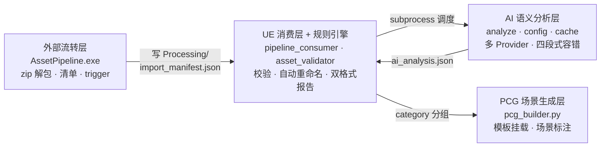

# UE5 AI 增强型资产智能管线

> 让资产管线长出大脑：AI 语义分析驱动的资产校验、智能命名与 PCG 场景生成全自动流水线 —— 支持 DeepSeek / OpenAI 多模型可插拔，Key 缺失零中断。

> 🚀 **下载即用**：非技术用户直接下载 `AssetPipeline.exe` **双击即可运行**，**首次运行会自动引导配置 DeepSeek API Key**（跳过则自动降级，管线照常运转）。

  

## 🎬 演示视频

[](https://www.bilibili.com/video/BV1a3Ji6gE7E)

[演示视频见 Bilibili: BV1a3Ji6gE7E]

## 核心亮点

### 1. 四层解耦架构

每一层都通过**文件契约**（JSON / trigger）+ `subprocess` 通信，可独立替换、独立调试：



| 层 | 职责 | 关键设计 |
| --- | --- | --- |
| 外部流转层 | 监听 Inbox，zip 解包、抄送 Content、生成清单 | mtime+size 双校验防写一半；产物只写 `Saved/`，不污染资产库 |
| AI 语义分析层 | 批量语义分析：命名建议 / 分类 / 中文描述 / 标签 | 多 Provider 可插拔；内容寻址缓存；失败整批降级 |
| UE 消费层 + 规则引擎 | 命名前缀与贴图设置校验、自动重命名、生成报告 | AI 层故障自动跳过，降级纯规则，管线不中断 |
| PCG 场景生成层 | 按 category 选挂预搭 PCG Graph，场景文字标注 | 探针验证 API 边界后走「模板化」方案，规避 UE 不可写参数 |

### 2. 大模型可插拔 + 四段式容错配置

不绑定任何单一模型服务商，切换 DeepSeek / OpenAI / 自托管模型**只改配置、不改代码**：

| 配置项 | 说明 | 默认 |
| --- | --- | --- |
| `AI_PROVIDER` | 提供商标识 | `deepseek` |
| `AI_API_KEY` | API Key | 无 |
| `AI_BASE_URL` | OpenAI 兼容接口地址 | 按提供商自动补全 |
| `AI_MODEL` | 模型名 | 按提供商自动补全 |

**四段式 Key 读取**：系统环境变量 → `.env` 文件 → 交互式输入 → 降级兜底

1. 优先读系统环境变量（`load_dotenv(override=False)` 保证优先级）
2. 其次读本地 `.env`（已入 `.gitignore`，Key 不进版本库）
3. 都没有则终端引导输入，选「1-DeepSeek / 2-OpenAI / 3-自定义」自动补全并**写回 .env 免二次输入**
4. 回车跳过 / 非终端环境（UE subprocess）→ 触发纯规则 / Mock 降级，**管线绝不因 Key 缺失中断**

API 层还带：指数退避重试（1s/2s/4s）、非法 JSON 多级剥壳解析、Key 全程不打印不入日志。

### 3. AI 语义驱动 + 内容寻址缓存

- 每条资产产出 `suggested_name / category / chinese_description / tags / confidence`，直接驱动校验与 PCG 布景
- **内容寻址缓存**：`SHA256(asset_path + mtime精确到毫秒 + file_size)` 定位，内容变了 Key 就变；TTL 30 天防规则漂移
- 缓存命中 = **零 API 调用**，重复资产、重跑管线近乎免费；单批 AI 成本 **< ¥0.02**，300+ 资产的批量分析与规则校验全链路如上流水线串行化

## 性能数据

| 指标 | 数据 |
| --- | --- |
| 批量处理吞吐 | 单批 300+ 资产 < 5 秒 |
| 重复资产成本 | 缓存命中，零 API 调用 |
| AI 调用成本 | < ¥0.02 / 批（DeepSeek 预设） |
| 故障恢复 | 3 次指数退避重试 → 整批降级，管线不中断 |

## 快速上手

### 开发者（推荐）

```bash
# 1. 安装 AI 层依赖（Python 3.12）
pip install -r src/ai_layer/requirements.txt

# 2. 写入通用 AI 配置（src/ai_layer/.env）
```

```dotenv
AI_PROVIDER=deepseek
AI_API_KEY=sk-xxxxxxxxxxxxxxxx
AI_BASE_URL=https://api.deepseek.com
AI_MODEL=deepseek-chat
```

```bash
# 3. 命令行直接跑 AI 语义分析
python src/ai_layer/analyze.py \
  --manifest import_manifest.json \
  --ue-content "<UE项目>/Content" \
  --output ai_analysis.json

# 4. UE 侧：把 plugin/AssetIntelligencePipeline 放入项目 Plugins/（或软链接），
#    资产 zip 丢进 Inbox，全链路自动流转
```

### 美术使用者（交互式引导，免 .env）

**只下载 `AssetPipeline.exe` 时**：双击运行，首次启动会弹出窗口引导粘贴 DeepSeek API Key（也可直接回车跳过，自动降级）。Key 会写入与 exe 同级的 `.env`，下次免输。

开发者 / 完整仓库用户：没有配置 Key 时，运行 `analyze.py` 会自动进入终端引导，三步完成接入：

```
未检测到 API Key，请手动输入（直接回车跳过，将启用纯规则/Mock 降级模式）：sk-xxxx
选择提供商（1-DeepSeek, 2-OpenAI, 3-自定义）：1
[配置] 配置已写入 .env，下次启动自动读取，无需重复输入。
```

直接回车跳过 → 自动降级为纯规则 / Mock 模式，**管线照常运转**——美术侧永远不需要碰配置文件。