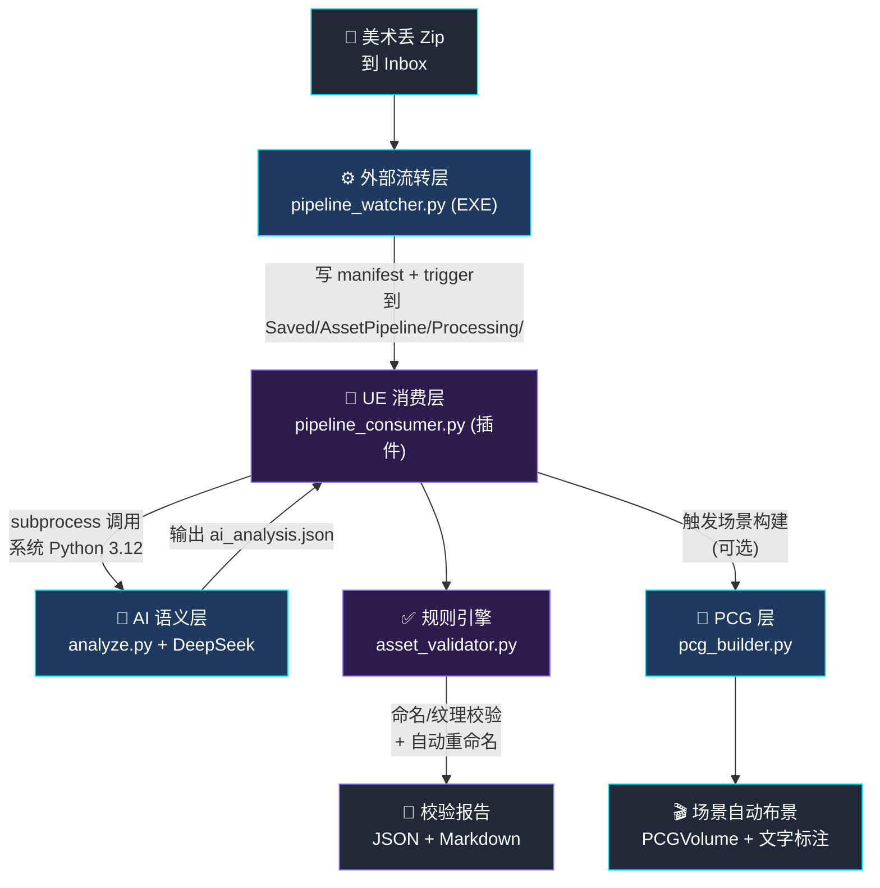

# 架构设计

## 四层架构总览

## 数据流说明

### 完整链路

1. **美术丢 Zip 到 Inbox**
2. **外部流转层**（`pipeline_watcher.py` 打包成 `AssetPipeline.exe`）
   - 轮询监听 Inbox
   - 检测 Zip 写入完成（mtime + size 稳定）
   - 解压到 `Processing/{zip_name}/`
   - 复制资产到 `<UE项目>/Content/Imported/`
   - 写 `import_manifest.json` + `trigger.txt` 到
     `<UE项目>/Saved/AssetPipeline/Processing/{zip_name}/`
3. **UE 消费层**（`pipeline_consumer.py`，UE 插件内）
   - 遍历 `Processing/*/trigger.txt`
   - 读 manifest 得到 assets 列表
   - 通过 subprocess 调用 AI 语义层
   - 拿到 `ai_analysis.json` 后执行规则校验 + 重命名
   - `trigger.txt` 改名 `trigger.txt.done`
4. **AI 语义层**（`analyze.py`，纯 Python + DeepSeek API）
   - 批量调 DeepSeek 分析资产语义
   - 输出 `suggested_name` / `category` / `chinese_description` / `tags` / `confidence`
   - 内容寻址缓存（asset_path + mtime + size）
   - API 失败/超时自动降级为 failures，不阻断主流程
5. **规则引擎**（`asset_validator.py`）
   - 命名前缀校验（SM_ / T_ / M_ / MI_ / BP_ / SK_ 等）
   - 贴图设置校验（sRGB + 压缩）
   - 命名不合规的资产自动重命名
   - 生成 JSON + Markdown 报告到 `Saved/AssetPipeline/Reports/`
6. **PCG 层**（`pcg_builder.py`，可选）
   - 读 `ai_analysis.json` 的 `category`
   - 按类别分组，每组挂载对应 PCG Graph 模板
   - 通过 TextRenderActor 在场景中标注 AI 分析结果
   - `Texture` / `UI` / `Audio` 类不参与布景

### 关键设计

- **失败降级不阻断**：AI 层故障时，消费层自动跳过语义增强，仅走规则引擎
- **内容寻址缓存**：基于 `asset_path + mtime浮点 + file_size` 的 SHA256
- **路径隔离**：manifest/trigger 写入 `Saved/`，不污染 UE 的 `Content/` 资产库
- **软链接开发**：仓库源码通过 Windows Junction 映射到 UE 项目 `Plugins/`，改动即时生效
- **模板化 PCG**：预搭 Graph 模板（方案 C-），Python 只负责选挂

### 探针结论（UE 5.7 PCG Python API 边界）

| 能力 | 结果 |
|---|---|
| 创建 PCGVolume | ✅ |
| 挂载 Graph 到 Volume | ✅ |
| 读 Graph 元数据 | ✅ |
| 动态改 Graph 参数 | ❌ `user_parameters` 不可写 |
| 动态注入 Mesh Entries | ❌ `PCGSoftISMComponentDescriptor.Mesh` 未暴露 |

因三条动态修改路径全不通，最终走"预搭 Graph 模板 + Python 按 category 选挂"的方案 C-。